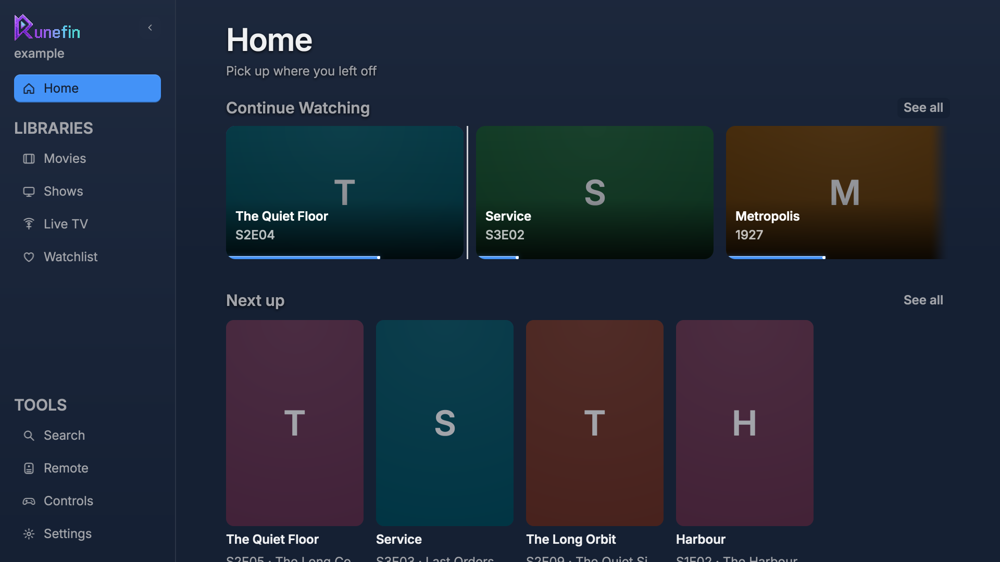

# Runefin

[](https://github.com/lifk/Runefin/actions/workflows/ci.yml)

A Jellyfin desktop client for Linux, drawn entirely by [Rune](https://github.com/anomalyco/rune) —
one GPU pass, no web view, no toolkit widgets. It is an independent project, not an official
Jellyfin client.



Runefin is a desktop app and a 10-foot TV app in the same binary. On a desktop it is a keyboard
and pointer client with the usual library, search, detail and settings screens. With
`--big-screen` it lays the same screens out on a 1280×720 point grid, goes fullscreen and drives
everything from a gamepad or an HDMI-CEC remote.

## What it does

- **Connect**: password sign-in, Quick Connect, LAN discovery, a session persisted with `0600`.
- **Home**: Continue Watching merged per series, Next Up, one Recently Added rail per library,
  Recently Played, Collections and an ambient backdrop.
- **Libraries**: virtualized grid and list views, sort, filters, genres, an A–Z rail, paged fetch
  with one-page prefetch and scroll restored on back.
- **Search**: `Ctrl+K` anywhere and `Ctrl+F` in a library, grouped Movies/Shows/Episodes/People
  results with see-all.
- **Detail**: shared-element poster, logo, scores, technical details, seasons and episodes, cast,
  recommendations, playlists, trailers and theme video.
- **Player**: zero-copy DMA-BUF GStreamer path (4K HEVC HDR10 on AMD), HDR tone mapping, OSD,
  trickplay, chapters, queue, up next, stats, audio tracks, text/ASS/PGS/VobSub/DVB subtitles,
  online subtitle search, skip intro/credits, speed, volume, fit/fill, mini player, fullscreen,
  MPRIS and a CPU plus `mpv` fallback.
- **Live TV**: channel list, guide grid, zapping, now/next, recordings and local program reminders.
- **Remote and cast**: open sessions, pause/resume/+30 s/stop, and “Play on…”.
- **Seerr (optional)**: if you run Jellyseerr/Seerr, Discover and Requests appear for film and
  season requests, request status and download progress.
- **Big screen**: a 64 pt safe gutter, a type ramp for couch distance, 4 pt focus rings, gamepad
  navigation and HDMI-CEC remote support.

The full inventory and the deliberate limits are in [`docs/features.md`](docs/features.md).

## Requirements

- Rust 1.85+ (edition 2024) to build.
- Linux with Vulkan (or a software ICD such as lavapipe), `libxkbcommon`, Wayland or X11. On
  Debian/Ubuntu: `libxkbcommon-dev libvulkan1`, plus `libudev-dev` to compile the controller
  listener.
- For in-app playback: GStreamer 1.28 with base/good/libav and, for the zero-copy path, VA-API.
  The CPU and `mpv` fallbacks work without VA-API.
- Optional: `ffmpeg` for bitmap subtitle extraction, `yt-dlp` for YouTube trailers, and a Jellyfin
  server with Live TV / a Seerr instance if you want those screens.

The Rune dependency is pinned to one commit of the fork's `runefin/player` branch in
`crates/runefin/Cargo.toml` — never a branch name. Upstream moves quickly; a floating dependency
means a build nobody changed.

## Install

### Flatpak (recommended on SteamOS and other immutable systems)

Add the signed repository once, then updates arrive with `flatpak update`:

```sh
flatpak remote-add --if-not-exists --user runefin https://lifk.github.io/Runefin/runefin.flatpakrepo
flatpak install --user runefin io.github.lifk.Runefin
flatpak run io.github.lifk.Runefin
flatpak update --user          # later
```

If you installed from a `.flatpak` bundle before, remove that copy once so this origin takes
over (`flatpak uninstall --user io.github.lifk.Runefin`); your settings stay in `~/.var/app`.

The offline bundle is still attached to every release:

```sh
curl -LO https://github.com/lifk/Runefin/releases/latest/download/Runefin-0.1.14-x86_64.flatpak
flatpak install --user ./Runefin-0.1.14-x86_64.flatpak
```

Packaging sources, the repository layout, controller notes and the CEC mapping live in
[`packaging/flatpak/`](packaging/flatpak/README.md). Bundles are attached to
[GitHub releases](https://github.com/lifk/Runefin/releases).

### From source

```sh
git clone https://github.com/lifk/Runefin
cd Runefin
cargo build --release
target/release/runefin
```

## Using it

```sh
target/release/runefin                # the release build
cargo run -p runefin                  # development build, same app
target/release/runefin --big-screen   # the TV mode
```

The session is stored in `~/.config/runefin/config.toml` with mode `0600`. Settings hold the
subtitle and audio defaults, playback step, text size, remappable player shortcuts, notifications,
volume, the OMDb fallback key and the Seerr connection; sign-out clears the session.

### Big screen and a controller

Desktop is the default. Big screen lays the same app out on a 1280×720 point grid (1.5× at 1080p,
3× at 4K), adds a 64 pt safe gutter, goes fullscreen and focuses the first item. Choose it in
Settings → Interface, or for one launch:

```sh
target/release/runefin --big-screen
target/release/runefin --big-screen --windowed   # same layout and keys in a window
RUNEFIN_UI=big target/release/runefin
```

`--windowed` keeps the TV layout, focus zones and key map but skips fullscreen, so the same
navigation can be driven from a laptop keyboard while iterating.

A gamepad works in either mode: D-pad/left stick moves, **A** selects, **B** goes back, **LB/RB**
change section, and **Start** opens a card menu or the player gear. `RUNEFIN_GAMEPAD=0` turns the
listener off.

On SteamOS an HDMI-CEC remote arrives as keyboard input, and Runefin's big-screen mode takes
Return as OK. Only the Menu buttons need a cecd mapping:
[`packaging/flatpak/setup-cecd.sh`](packaging/flatpak/setup-cecd.sh) merges it into
`~/.config/cecd/config.toml` (backing the file up first), and
[`cecd.toml`](packaging/flatpak/cecd.toml) is the same mapping as a reference.

## Development

```sh
cargo test -p jellyfin-api    # wire types and URLs, no network
cargo test -p seerr-api       # the Seerr client, no network
cargo test -p runefin         # headless UI tests through the real layout and springs
scripts/check.sh              # fmt, clippy, both suites, release build
scripts/snapshots.sh          # the eight committed views
scripts/snapshots.sh --all    # every scene, into /tmp/runefin-snapshots
scripts/install-hooks.sh      # once per clone: refuse tokens and private hosts in a commit
```

The UI tests drive real input through Rune's `Runtime` and assert on state and presented geometry,
never on colour. A change that can move pixels ships with regenerated snapshots; an intended diff
says why in the commit.

Live contract tests are opt-in and need a server of your own:

```sh
JELLYFIN_URL=https://jellyfin.example JELLYFIN_USER_ID=... JELLYFIN_TOKEN=... \
  cargo test -p jellyfin-api --test live -- --ignored --nocapture

SEERR_URL=https://jellyseerr.example SEERR_API_KEY=... \
  cargo test -p seerr-api --test live -- --ignored --nocapture
```

## Documentation

- [`docs/design.md`](docs/design.md) — the browse-app contract.
- [`docs/design-player.md`](docs/design-player.md) — playback, DMA-BUF, HDR.
- [`docs/features.md`](docs/features.md) — what ships and what deliberately does not.
- [`docs/engineering.md`](docs/engineering.md) — architecture, measurements and traps.
- [`docs/snapshots/`](docs/snapshots/README.md) — the visual contract, one PNG per scene.
- [`docs/research/`](docs/research/) — the evidence behind the design decisions.

## Contributing and security

See [`CONTRIBUTING.md`](CONTRIBUTING.md) for the build, the conventions and the review rules, and
[`SECURITY.md`](SECURITY.md) for how to report a vulnerability privately. Please do not open a
public issue containing a server token, a private hostname or personal library data.

## How it is built

Runefin is developed with AI assistance. Most of the code, tests, documentation and snapshots in
this repository were written by an AI coding agent working from human direction and review. Every
change is expected to pass `scripts/check.sh` (formatting, clippy, three test suites, a release
build) and, when it can move pixels, to ship with regenerated snapshots.

That is a statement about how the code was produced, not a promise about its quality. Read what
you run, keep your server patched, and report what breaks.

The fixtures behind the screenshots use public-domain films (for example *Metropolis* and *Night
of the Living Dead*) and invented series, episodes, channels and people. No third-party artwork
is included; see [`THIRD_PARTY_NOTICES.md`](THIRD_PARTY_NOTICES.md).

## Licence and disclaimer

Runefin is licensed under the [MIT licence](LICENSE). Third-party components bundled with a build,
including Rune, its embedded fonts and the vendored `wgpu-external-frame`, are listed in
[`THIRD_PARTY_NOTICES.md`](THIRD_PARTY_NOTICES.md).

Runefin is not affiliated with, endorsed by or supported by the Jellyfin project, Valve
Corporation, Steam, the Rune project or any streaming service. “Jellyfin” is a trademark of its
respective owners and is used here only to describe what the app talks to. You supply the server,
the media and the accounts; the project ships no media and no service.
